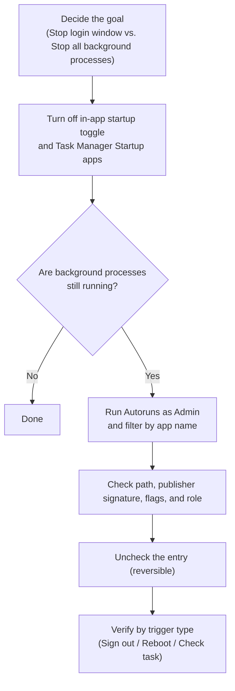

# Where Do Windows Startup Programs Actually Live?

<!-- DESC SEP -->

Why disabling an app in Task Manager's Startup tab still leaves background processes running, and how logon items, services, and scheduled tasks fit together.

<!-- DESC SEP -->

After installing a cloud drive or an input method on Windows, stopping it from launching at boot usually takes two steps: uncheck "Launch on startup" in the app's own settings, then open Task Manager, switch to Startup apps, and set it to "Disabled."

You reboot, log in, and the desktop is clean. No main window pops up; no icon sits in the tray.

Then you scroll down the Processes tab in Task Manager and spot `*Service.exe` or `*Updater.exe` from the exact same vendor humming along in memory.

Intuitively, "launch on startup" feels like a master switch for the whole program. Turn it off, and nothing belonging to that app should run on its own.

Under the hood of Windows, though, a modern desktop application is rarely a single `.exe`. Any reasonably featured program usually splits itself into three pieces:

1. **GUI Client**: Draws the window and tray icon when you interact with it;
2. **Windows Service**: Handles background sync, networking, or tasks that need administrator privileges;
3. **Scheduled Task**: Wakes up every few hours to check for updates or upload logs.

The "Startup apps" list in Task Manager only governs the first piece—the graphical client launched when you sign in to the desktop. Background services and scheduled tasks answer to two completely separate subsystems that never look at that toggle.

## Boot, logon, and triggered execution

To trace where a lingering process actually comes from, it helps to ask three questions:

| Dimension | Core Question                    | Common Answers                                                                       |
| :-------- | :------------------------------- | :----------------------------------------------------------------------------------- |
| **When**  | When does it start?              | System boot, user logon, a clock schedule, or a system event                         |
| **Who**   | Whose permissions does it use?   | System accounts (`SYSTEM` / `LOCAL SERVICE`) or the signed-in user                   |
| **How**   | What process spawns it?          | Service Control Manager (SCM), Windows Explorer (`explorer.exe`), or Task Scheduler  |

The easiest pair to conflate is **system boot** and **user logon**.

System boot happens when the machine powers on, loads the kernel and hardware drivers, and starts the Service Control Manager (SCM). Nobody has signed in yet; the screen is still sitting at the lock screen. Everything running at this stage is a background service or driver with no desktop window.

User logon begins only after you type your password or pass Windows Hello. Windows creates your interactive session, starts the desktop shell (`explorer.exe`), and walks through the list of graphical apps that asked to be launched with your desktop.

## Logon startup: Settings, folders, and the Registry

The programs that launch when you sign in are the ones built-in tools show you first.

### Settings and Task Manager

Windows 10 and 11 offer two graphical views for logon apps:
- **Settings**: Settings > Apps > Startup
- **Task Manager**: The Startup apps tab

As Microsoft notes in [configuring startup applications in Windows](https://support.microsoft.com/en-gb/windows/experience/startup-boot/configure-startup-applications-in-windows), both screens read the exact same underlying list. Settings gives you simple switches; Task Manager adds startup impact estimates and command-line arguments.

### The two Startup folders

Pressing `Win + R` opens direct shortcuts to two legacy startup folders that Windows still honors on every sign-in:

- Type `shell:startup` for the **current user** folder:
  ```text
  %APPDATA%\Microsoft\Windows\Start Menu\Programs\Startup
  ```
- Type `shell:common startup` for the **all users** folder:
  ```text
  %PROGRAMDATA%\Microsoft\Windows\Start Menu\Programs\Startup
  ```

Even shortcuts placed in the "all users" folder wait until someone signs in to the desktop—they just run for whichever account logs on.

### Registry Run and RunOnce keys

Most installers skip folders and write directly to the Registry. Following Microsoft's [Run and RunOnce Registry Keys](https://learn.microsoft.com/en-us/windows/win32/setupapi/run-and-runonce-registry-keys) specification, these entries live in two main scopes:

1. **Current User (HKCU)**:
   ```text
   HKEY_CURRENT_USER\Software\Microsoft\Windows\CurrentVersion\Run
   HKEY_CURRENT_USER\Software\Microsoft\Windows\CurrentVersion\RunOnce
   ```
2. **Local Machine (HKLM)**:
   ```text
   HKEY_LOCAL_MACHINE\Software\Microsoft\Windows\CurrentVersion\Run
   HKEY_LOCAL_MACHINE\Software\Microsoft\Windows\CurrentVersion\RunOnce
   ```
   (32-bit apps on 64-bit Windows also use the `HKLM\Software\WOW6432Node\...` branch.)

`Run` keys fire every time a matching user signs in. `RunOnce` keys fire once—typically to finish an installation after a reboot—and Windows deletes the value before launching the command so a crashing installer cannot loop forever. Prefixing the value name with `!` defers deletion until the command exits cleanly.

## Deeper hooks: Services and Scheduled Tasks

When an app does not appear in Startup apps at all yet keeps showing up in memory, its hook is almost always a Windows Service or a Scheduled Task.

### The "Manual" trap in Windows Services

Press `Win + R` and run `services.msc` to inspect [automatically starting services](https://learn.microsoft.com/en-us/windows/win32/services/automatically-starting-services) managed by the SCM. When looking at a service, separate its **current status** from its **startup type**:

| Startup Type                  | Actual Behavior                                                                   |
| :---------------------------- | :-------------------------------------------------------------------------------- |
| **Automatic**                 | Started by the SCM during system boot, before anyone logs on                      |
| **Automatic (Delayed Start)** | Started shortly after boot once core services settle, easing early disk contention |
| **Manual**                    | Does not start on boot by itself, but wakes up whenever another component asks    |
| **Disabled**                  | Blocked completely; cannot be started by users or dependencies                    |

"Manual" catches many people off guard. Setting a service to Manual does not mean it stays off. Since Windows 7, services can register [Service Trigger Events](https://learn.microsoft.com/en-us/windows/win32/services/service-trigger-events)—waking up automatically the moment a network interface comes online, a USB device is plugged in, or a port opens. As soon as that condition fires, the SCM starts the "Manual" service right up.

### Scheduled Tasks and delayed triggers

Running `taskschd.msc` opens Task Scheduler.

Under Microsoft's [Task Triggers](https://learn.microsoft.com/en-us/windows/win32/taskschd/task-triggers) model, a scheduled task combines four pieces:
- **Trigger**: When to run—at boot, at logon, on a timer, or "15 minutes after user logon" (a favorite trick for avoiding boot-time slowdowns);
- **Action**: Which executable and flags to run;
- **Principal**: Which account runs it—choosing `SYSTEM` with "Run whether user is logged on or not" lets a background worker run invisibly without a desktop session;
- **Conditions**: Extra rules like waiting for AC power or an internet connection.

> [!NOTE]
> Many background services and tasks deliver security patches or hardware helper functions. Always check what an executable actually does before disabling it so you do not break updates or peripheral features.

## Putting the pieces on one screen with Autoruns

Jumping between Settings, Regedit, `services.msc`, and `taskschd.msc` is tedious, and it is easy to miss a stray hook.

Microsoft's Sysinternals suite has a single tool built for this: [Autoruns for Windows](https://learn.microsoft.com/en-us/sysinternals/downloads/autoruns). It sweeps nearly every autostart location in Windows into one table.

Run Autoruns as Administrator and check `Options > Hide Microsoft Entries` to clear out built-in OS noise. Four tabs cover most investigations:

- **Logon**: Registry `Run` keys, Startup folders, and login hooks;
- **Services**: Third-party Windows services;
- **Scheduled Tasks**: Third-party scheduled tasks;
- **Drivers**: Third-party kernel drivers loaded at boot.

Type an app or vendor name into the top `Filter` box and every hook it registered across all subsystems lines up immediately. Right-click any row and choose `Jump to Entry` to open the exact Registry key or console entry, or `Jump to Image` to reveal the binary in File Explorer.

Two habits keep Autoruns safe:

1. **Uncheck instead of Delete**: Unchecking a row moves the configuration into a backup key (such as `AutorunsDisabled`) rather than destroying it. If something breaks, re-checking the box restores it right away; `Delete` wipes it for good.
2. **Leave shell extensions and drivers alone**: The `Explorer` tab lists right-click context menu and thumbnail DLLs that only load when you open a folder, not background daemons running at boot. And the `Drivers` tab touches kernel stability directly—leave it untouched unless you are debugging a specific hardware fault.

## A clean audit sequence

When taming a noisy application, walking through five steps in order keeps you out of trouble:



Match your verification step to the mechanism you changed:
- **Logon items (`Logon`)**: **Sign out and sign back in**—no full reboot needed;
- **Services (`Services`)**: **Restart the computer** so the SCM runs a fresh boot sequence;
- **Scheduled Tasks (`Scheduled Tasks`)**: Confirm the task shows "Disabled" in Task Scheduler.

Change one item at a time and test right away.

## Why Linux's systemctl feels cleaner

Anyone who moves between Linux and Windows usually notices how much calmer service management feels on modern Linux. Most of that clarity comes from systemd.

On Debian or Ubuntu, background daemons are defined as `.service` units and controlled through one consistent command:

```bash
# Check current state and recent logs
systemctl status example.service

# Start or stop right now
sudo systemctl start example.service
sudo systemctl stop example.service

# Enable or disable starting on boot
sudo systemctl enable example.service
sudo systemctl disable example.service
```

systemd cleanly separates **whether a service is running right now** (`start` / `stop`) from **whether it should start at boot** (`enable` / `disable`).

As the [systemctl manual](https://www.freedesktop.org/software/systemd/man/latest/systemctl.html) points out, `systemctl disable` only removes the boot symlink—it does not stop a running process, and the service can still be woken on demand by another unit, a socket, or D-Bus. Blocking it completely takes `systemctl mask`.

Under the hood, the Windows Service Control Manager is every bit as capable. From an elevated prompt, [sc.exe config](https://learn.microsoft.com/en-us/windows-server/administration/windows-commands/sc-config) gives you the same control:

```cmd
REM Note: The space after start= is required
sc.exe config "ExampleService" start= disabled
sc.exe stop "ExampleService"
```

And Linux desktops also manage graphical login apps separately from systemd, using `.desktop` files in `~/.config/autostart/` under the [XDG Autostart specification](https://specifications.freedesktop.org/autostart/latest/).

So why does Windows startup management still feel so frustrating?

The friction comes from a **mismatch of perspective**.

A user thinks in terms of **an application**: "I don't want this cloud drive running behind my back." Windows, however, organizes its built-in controls by **OS mechanism**: login windows go to Task Manager, daemons go to `services.msc`, timers go to `taskschd.msc`.

An installer can scatter hooks across all three subsystems in half a second, while the user is left playing system administrator—opening three different consoles just to tell one piece of software to stay quiet.
