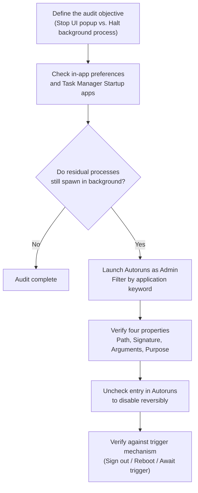

# Where Do Windows Startup Programs Actually Live?

<!-- DESC SEP -->

Users want to control whether an application runs automatically, but Windows scatters startup logic across login items, background services, and scheduled tasks. Here is how those mechanisms differ and how to audit them.

<!-- DESC SEP -->

## Disabling Startup Apps Doesn't Always Stop Background Processes

Consider a familiar scenario on Windows 11. You install a cloud storage client or an input method editor equipped with automatic updates. You prefer it not to launch at boot, so you uncheck "Launch on startup" within the application settings. For good measure, you open Task Manager, locate the entry under Startup apps, and toggle its status to "Disabled."

After restarting your computer and logging in, no application window appears, and no icon shows up in the system tray. Yet when you open Task Manager and scroll through the Details or Background Processes tabs, an executable named `*Service.exe` or `*Updater.exe` from that same program is still running quietly in the background, consuming memory and CPU cycles.

Users often interpret this as a failure of the software to respect startup preferences. From an intuitive standpoint, "launch on startup" feels like a single switch governing the entire application. If toggled off, no component associated with that software should run unprompted.

In the architectural reality of Windows, however, modern desktop software rarely consists of a single binary. A complete application typically splits responsibilities across three loosely coupled components:

1. **GUI Client**: Handles user interaction, presenting windows and tray icons on the interactive desktop.
2. **Windows Service**: Manages cross-session file synchronization, low-level networking, or background maintenance requiring elevated privileges.
3. **Scheduled Task**: Periodically triggers version checks, telemetry reporting, or cache cleanup.

When you disable an entry in Task Manager, Windows only shuts off the path that launches the GUI client when a user logs on. Background services and scheduled tasks belong to separate management subsystems. They continue to run according to the rules established during installation.

While not every application adopts this architecture, the pattern highlights a fundamental gap: Windows lacks a centralized master switch to govern all automated behaviors of an application.

## Distinguishing Boot, Logon, and Triggered Execution

To locate where a program actually originates, one must look beyond a single settings page and evaluate execution along three distinct axes:

| Dimension | Core Question | Common Values and Characteristics |
| :--- | :--- | :--- |
| **When** | When does execution begin? | System boot, user logon, specific clock time, system event trigger |
| **Who** | What security identity is used? | High-privilege system accounts (`SYSTEM` / `LOCAL SERVICE`), interactive user account |
| **How** | Who spawns the process? | Service Control Manager (SCM), Windows Explorer (`explorer.exe`), Task Scheduler engine |

The most common point of confusion lies between **system boot** and **user logon**.

System boot refers to the hardware initialization sequence, kernel loading, driver setup, and initialization of the Service Control Manager. At this stage, no user has authenticated, and the display remains at the lock screen or credential prompt. Programs executing during this window are almost exclusively Windows services and kernel drivers running under elevated system accounts. They lack a graphical desktop session and cannot render interactive windows.

User logon occurs only after credentials pass verification through a password or Windows Hello. Windows then establishes an interactive desktop session, loads the user profile, and launches the desktop shell `explorer.exe`. The startup programs visible in Task Manager operate almost entirely within this phase.

Furthermore, management interfaces in Windows do not map one-to-one with underlying system mechanisms. A single configuration entry can surface in multiple system utilities, while items listed together in one dialog may stem from completely different registry branches or file directories.

## Logon Startup: Settings, Folders, and the Registry

Programs configured to launch upon desktop logon represent the most common category of startup items and the primary focus of built-in management utilities.

### Unified View in Settings and Task Manager

Windows 10 and Windows 11 provide two primary graphical interfaces for managing logon applications:

- **Settings**: Located at Settings > Apps > Startup.
- **Task Manager**: Located on the Startup apps tab (labeled "Startup" in Windows 10).

Microsoft's official documentation on [configuring startup applications in Windows](https://support.microsoft.com/en-gb/windows/experience/startup-boot/configure-startup-applications-in-windows) confirms that both interfaces query the same underlying registry entries and folder shortcuts. The distinction lies in presentation: Settings provides clean toggle switches, while Task Manager exposes startup impact estimates (calculated from CPU and disk utilization), full command-line arguments, and verified publisher details.

This unified list exclusively tracks desktop binaries executed by the shell during logon. It does not inspect services or scheduled tasks.

### Startup Folders: Per-User and All Users

Shortcut-based execution remains an active backward-compatibility mechanism. Opening the Run dialog (`Win + R`) gives direct access to two startup folders:

- **Current User Startup Folder**: Accessed via `shell:startup`, resolving to:
  ```text
  %APPDATA%\Microsoft\Windows\Start Menu\Programs\Startup
  ```
  Shortcuts placed here run only when the specific account logs in.

- **All Users Startup Folder**: Accessed via `shell:common startup`, resolving to:
  ```text
  %PROGRAMDATA%\Microsoft\Windows\Start Menu\Programs\Startup
  ```
  Shortcuts in this directory still trigger during the user logon phase, not during pre-logon system boot. The distinction is that Windows iterates through this folder whenever any account signs in to the desktop.

### Registry Run and RunOnce Keys

Most traditional desktop installers register autostart entries directly in the Windows Registry. Microsoft's specification for [Run and RunOnce Registry Keys](https://learn.microsoft.com/en-us/windows/win32/setupapi/run-and-runonce-registry-keys) details their behavior.

Entries are divided between two scopes:

1. **Current User (HKCU)**:
   ```text
   HKEY_CURRENT_USER\Software\Microsoft\Windows\CurrentVersion\Run
   HKEY_CURRENT_USER\Software\Microsoft\Windows\CurrentVersion\RunOnce
   ```
2. **Local Machine (HKLM)**:
   ```text
   HKEY_LOCAL_MACHINE\Software\Microsoft\Windows\CurrentVersion\Run
   HKEY_LOCAL_MACHINE\Software\Microsoft\Windows\CurrentVersion\RunOnce
   ```
   On 64-bit systems hosting 32-bit binaries, the WoW64 redirection key also applies:
   ```text
   HKEY_LOCAL_MACHINE\Software\WOW6432Node\Microsoft\Windows\CurrentVersion\Run
   ```

`Run` and `RunOnce` exhibit distinct execution semantics:

- Entries under `Run` execute on every matching user logon.
- Entries under `RunOnce` handle one-time setup or maintenance tasks. The operating system removes the value before launching the command, preventing recurring execution loops if the executable crashes.

The documentation also notes specific constraints for `HKLM RunOnce`. By default, these items execute sequentially before standard `Run` items; prefixing an entry with an exclamation mark (`!`) delays deletion until the process exits; and Safe Mode skips them entirely unless marked with an asterisk (`*`). Understanding these paths helps track down elusive startup entries without needing to edit the registry directly for routine maintenance.

## Background Services and Scheduled Tasks

When an application leaves no trace in logon startup lists yet persistently reappears in background processes, its activation logic resides in Windows services or scheduled tasks.

### Service States and Startup Types

Executing `services.msc` via `Win + R` opens the Windows Services console.

As detailed in Microsoft's documentation on [automatically starting services](https://learn.microsoft.com/en-us/windows/win32/services/automatically-starting-services), Windows services are orchestrated by the Service Control Manager (SCM). Auditing a service requires separating its **current status** from its configured **startup type**:

| Startup Type | Behavior |
| :--- | :--- |
| **Automatic** | Loaded by the SCM during system boot, prior to user logon, supporting core background duties. |
| **Automatic (Delayed Start)** | Spawns shortly after boot once critical services stabilize, minimizing early I/O contention. |
| **Manual** | Idle at boot; waits for another application or user action to explicitly invoke it. |
| **Disabled** | Completely blocked from starting by the SCM; cannot be launched by applications or dependencies. |

The "Manual" type requires scrutiny. Setting a service to Manual does not guarantee it stays stopped. Since Windows 7, the architecture supports [Service Trigger Events](https://learn.microsoft.com/en-us/windows/win32/services/service-trigger-events). A service can register trigger conditions such as network interface initialization, hardware device insertion, or firewall port adjustments. Even if configured as Manual, the SCM automatically spins up the service the moment its trigger condition is met.

### Scheduled Task Triggers and Execution Parameters

Opening `taskschd.msc` launches the Task Scheduler console.

Task Scheduler functions as a general-purpose automation engine. Under the official [Task Triggers](https://learn.microsoft.com/en-us/windows/win32/taskschd/task-triggers) specification, an automated task centers around four components:

- **Trigger**: Defines when the task runs. Triggers include system startup, user logon, specific calendar intervals, idle states, or Event Log occurrences. Many background updaters configure a trigger like "15 minutes after user logon" to bypass boot-time scrutiny.
- **Action**: Defines the command and arguments executed.
- **Principal**: Specifies the security account under which the task runs. If configured to run as `SYSTEM` with "Run whether user is logged on or not," the task executes in isolation from the interactive desktop.
- **Conditions**: Defines prerequisites, such as requiring AC power or an active network connection.

> [!NOTE]
> Background services and scheduled tasks often handle automated version updates and security patch deployment. Disabling update workers may leave an application unpatched against known vulnerabilities, or disrupt features that depend on persistent local synchronization. Always confirm a component's specific role before turning it off.

## Unifying the View with Sysinternals Autoruns

Hunting through Settings, registry branches, the Services console, and Task Scheduler is inefficient and prone to oversight.

The official Sysinternals utility [Autoruns for Windows](https://learn.microsoft.com/en-us/sysinternals/downloads/autoruns) solves this fragmentation by consolidating virtually every auto-starting hook into a single unified workspace.

### Core Tabs and Keyword Filtering

When launching Autoruns as Administrator, navigate to `Options` and enable `Hide Microsoft Entries` to filter out default operating system components.

Auditing typically focuses on four primary tabs:

- **Logon**: Aggregates all user-session autostart entries, including registry `Run` keys, Startup folders, and Active Setup hooks.
- **Services**: Lists all third-party services alongside their image paths and publisher signatures.
- **Scheduled Tasks**: Displays third-party tasks and their underlying scripts or binaries.
- **Drivers**: Details third-party kernel drivers loaded during boot.

Typing an application name, executable string, or installation directory into the top `Filter` box immediately isolates matching items across all subsystems. Right-clicking any entry allows instant inspection via `Jump to Entry` (opening the relevant registry key) or `Jump to Image` (opening the file location in File Explorer).

### Essential Operational Distinctions

Working effectively with Autoruns requires understanding two underlying principles:

1. **Unchecking vs. Deleting**:
   - Unchecking an entry does not destroy the configuration. Autoruns backs up the value into an isolated subkey (such as `AutorunsDisabled`) or renames the task file. This operation is fully reversible: re-checking the box immediately restores normal execution.
   - Using `Delete` permanently removes the registry value or task file, offering no undo mechanism unless an external backup exists.

2. **Persistent Processes vs. On-Demand Extensions**:
   - Autoruns inspects shell extensions (`Explorer`), context menu handlers, and preview handlers. These items are dynamic link libraries (DLLs) loaded into memory only when the shell performs a relevant action, such as right-clicking a file. They do not represent independent background processes consuming persistent memory at boot. Do not disable them indiscriminately.
   - The `Drivers` tab directly influences hardware initialization and kernel stability. Unless diagnosing a specific driver conflict, leave driver entries untouched.

## A Practical Troubleshooting Sequence

When investigating an application's startup footprint, following a structured sequence prevents unintended system disruption:



### 1. Define the Audit Objective

Clarify what outcome is expected: are you only trying to prevent a main window from popping up at boot, or do you require that no background services or update monitors load unless manually launched? The target dictates where intervention must occur.

### 2. Prioritize In-App Settings and Startup Apps

Well-behaved applications expose startup toggles within their preferences. Disabling autostart inside the app is the cleanest approach, as the software typically deregisters its own scheduled tasks or adjusts its service startup types cleanly.

Next, confirm in Task Manager under Startup apps that the main client shows as "Disabled." If the goal was simply stopping a splash screen and no unwanted background tasks remain, no further changes are needed.

### 3. Use Autoruns to Isolate Residual Hooks

If the application lacks an internal toggle to exit cleanly, and background processes still linger, launch Autoruns as Administrator. Enter the application keyword in the `Filter` field and examine the `Logon`, `Services`, and `Scheduled Tasks` tabs.

### 4. Verify Four Properties Before Disabling

Before disabling an entry, verify four details:

- **Full File Path**: Ensure the binary resides within the target application's directory rather than a core Windows system folder.
- **Publisher Signature**: Verify the authenticity of the digital signature.
- **Command Line Arguments**: Check flags (such as `--check-updates` or `--crash-handler`) to determine the process's actual duty.
- **Functional Purpose**: Assess whether turning off this component impairs needed features like file sync or hardware peripheral integration.

Once confirmed, **uncheck the entry** rather than deleting it, preserving a straightforward rollback path.

### 5. Verify Against the Specific Trigger Mechanism

Validate changes using the test corresponding to the altered mechanism:

- **Logon Entries (`Logon`)**: Simply **sign out and sign back in**. Windows reloads the desktop shell without requiring a full machine reboot.
- **Services or Drivers (`Services` / `Drivers`)**: You must **restart the computer**. The SCM only applies boot-time service policies during a fresh system startup sequence.
- **Scheduled Tasks (`Scheduled Tasks`)**: Check Task Scheduler to confirm the task reflects a "Disabled" state, or run it manually to confirm execution is intercepted.

Throughout the process, adjust one item at a time and verify immediately. Never disable unfamiliar items in bulk without understanding their purpose.

## Why systemctl Feels More Intuitive

Developers moving between Linux and Windows often note that managing background services feels significantly more transparent on modern Linux distributions. That clarity stems primarily from the cohesive architecture of systemd.

On distributions such as Debian or Ubuntu, systemd models all managed workloads as Units, with background daemons defined in `.service` files. It exposes a uniform command-line interface:

```bash
# Inspect current status and recent log entries
systemctl status example.service

# Immediately start or stop an active service
sudo systemctl start example.service
sudo systemctl stop example.service

# Enable or disable automatic launch on boot
sudo systemctl enable example.service
sudo systemctl disable example.service
```

Under systemd, operational concepts are strictly decoupled:

- **Active State**: Tracks whether the service is currently running in memory (`active` or `inactive`), manipulated via `start` and `stop`.
- **Unit File State**: Tracks whether systemd establishes dependency symlinks to load the unit during target initialization (such as `multi-user.target`), manipulated via `enable` and `disable`.

This design maintains clear technical boundaries. As outlined in the [systemctl manual](https://www.freedesktop.org/software/systemd/man/latest/systemctl.html), running `systemctl disable` merely unlinks the boot dependency; **it does not terminate a currently running daemon**. Furthermore, a disabled service can still be started on demand if invoked by an active dependency, socket activation, or a D-Bus message. To block all invocation completely, one must run `systemctl mask`.

This does not mean the Windows service infrastructure is fundamentally inferior.

In reality, the Windows Service Control Manager is a mature, centralized service orchestration framework. Native administration tools provide fine-grained control from the command line, as illustrated in the documentation for [sc.exe config](https://learn.microsoft.com/en-us/windows-server/administration/windows-commands/sc-config):

```cmd
REM Note: The space after start= is mandatory
sc.exe config "ExampleService" start= disabled
sc.exe stop "ExampleService"
```

Likewise, Linux desktop environments manage graphical autostart independently of systemd, relying on the freedesktop.org [XDG Desktop Application Autostart Specification](https://specifications.freedesktop.org/autostart/latest/) through `.desktop` files in `~/.config/autostart/`.

Why, then, does Windows consistently leave users feeling that startup management is fragmented and opaque?

The disconnect lies in the **mismatch between user mental models and fragmented system aggregation**.

On the Windows desktop, the startup controls presented to regular users are confined to a narrow slice of logon applications. Third-party software vendors, however, routinely scatter background automation across registry `Run` keys, Windows services, scheduled tasks, and even driver hooks.

A user's intent is straightforward: they want to control whether a specific piece of software runs automatically. But the operating system requires them to act as enterprise administrators, jumping between disconnected management consoles and registry paths to piece together the full picture. Because Windows lacks an application-centric aggregation model to manage all startup facets in one place, the cognitive burden of discovery and maintenance falls entirely on the user.
