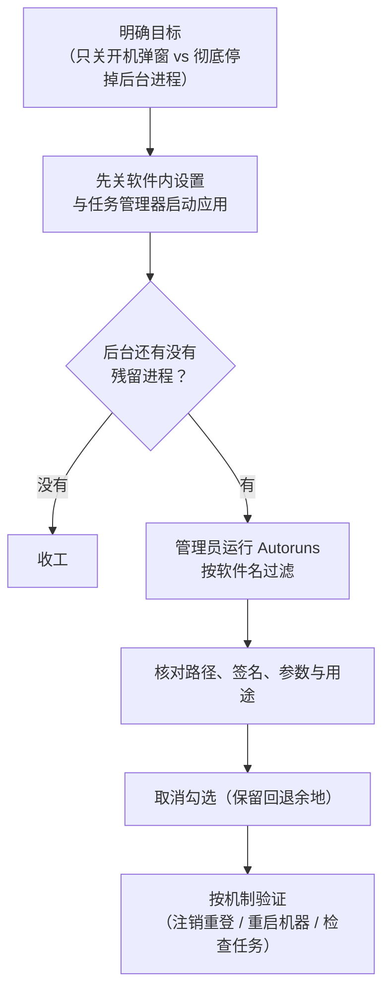

# Windows 启动项，到底该去哪里管？

<!-- DESC SEP -->

关掉任务管理器里的“启动应用”后后台依然有进程在跑，理清登录项、系统服务与计划任务各自的边界。

<!-- DESC SEP -->

在 Windows 上装完一款网盘或输入法，如果你不想让它开机自启，通常会做两件事：先去软件设置里取消“开机启动”，再打开任务管理器，切到“启动应用”，把状态改成“已禁用”。

重启电脑，桌面干干净净，右下角托盘里也没有图标。

可一旦切到任务管理器的“进程”列表往下翻，往往还是能看到同一个厂商名下的 `*Service.exe` 或 `*Updater.exe` 安安静静地待在内存里。

在直觉里，“开机自启”应该是一道总闸：关上它，这款软件就不该自己跑起来。

但在 Windows 的设计里，一款桌面软件很少只是一个单独的 `.exe`。稍微复杂一点的软件，通常会把自己拆成三截：

1. **图形客户端（GUI Client）**：画窗口、放托盘图标，负责和你打交道；
2. **后台服务（Windows Service）**：管跨会话同步、网络通信或需要管理员权限的脏活；
3. **计划任务（Scheduled Task）**：每隔几个小时偷偷醒来一次，检查更新或上报日志。

任务管理器里的“启动应用”，管的其实只是第一截——也就是你登录桌面时顺手拉起的那个主窗口。至于后台服务和计划任务，它们归另外两套独立的子系统管，压根不看那个开关的脸色。

## 先分清：开机、登录与按条件触发

要想摸清一个进程到底是从哪冒出来的，可以先问三个问题：

| 维度             | 关键问题         | 常见答案                                                |
| ---------------- | ---------------- | ------------------------------------------------------- |
| **时机（When）** | 它什么时候跑？   | 机器通电引导（Boot）、用户登录桌面（Logon）、定时或事件 |
| **身份（Who）**  | 它顶着谁的权限？ | 系统高权限账户（`SYSTEM` / `LOCAL SERVICE`）、当前用户  |
| **拉起者（How）**| 谁把它叫醒的？   | 服务控制管理器（SCM）、桌面外壳（`explorer.exe`）、计划任务引擎 |

这里最容易混淆的是**系统启动（Boot）**和**用户登录（Logon）**。

系统启动，指的是按下电源键、加载内核与驱动、拉起服务控制管理器（SCM）的那段时间。这时候屏幕还停在锁屏界面，没有任何人登录。在这个阶段跑起来的，全是不需要桌面窗口的系统服务和底层驱动。

等你输完密码或刷完脸进入桌面，才叫用户登录。系统为你建好会话，启动桌面外壳 `explorer.exe`，再顺着清单把一堆图形软件拉起来。

## 登录自启：设置、文件夹与注册表

平时打交道最多的，就是登录桌面这一刻触发的程序。

### 设置与任务管理器

Windows 10 和 11 提供了两个图形入口：
- **系统设置**：“设置 > 应用 > 启动”
- **任务管理器**：“启动应用”标签页

微软在[配置启动应用程序](https://support.microsoft.com/en-gb/windows/experience/startup-boot/configure-startup-applications-in-windows)文档里写得很明白：这两个界面读的是同一份底层清单。系统设置只给开关；任务管理器多展示了几列信息，比如启动影响评估和命令行参数。

### 两个启动文件夹

按 `Win + R` 打开运行窗口，可以直达两处古老但依然有效的启动文件夹：

- 输入 `shell:startup`，打开**当前用户**的启动目录：
  ```text
  %APPDATA%\Microsoft\Windows\Start Menu\Programs\Startup
  ```
- 输入 `shell:common startup`，打开**所有用户共用**的启动目录：
  ```text
  %PROGRAMDATA%\Microsoft\Windows\Start Menu\Programs\Startup
  ```

哪怕放在“所有用户共用”目录下，它依然要等某个人登录进桌面才会跑，而不是在锁屏之前跑。区别只在于，谁登录它就跟谁跑一次。

### 注册表里的 Run 与 RunOnce

大多数安装程序更喜欢直接写注册表。按照微软 [Run 与 RunOnce 注册表键](https://learn.microsoft.com/en-us/windows/win32/setupapi/run-and-runonce-registry-keys)规范，最常见的位置有两处：

1. **当前用户（HKCU）**
   ```text
   HKEY_CURRENT_USER\Software\Microsoft\Windows\CurrentVersion\Run
   HKEY_CURRENT_USER\Software\Microsoft\Windows\CurrentVersion\RunOnce
   ```
2. **整台机器（HKLM）**
   ```text
   HKEY_LOCAL_MACHINE\Software\Microsoft\Windows\CurrentVersion\Run
   HKEY_LOCAL_MACHINE\Software\Microsoft\Windows\CurrentVersion\RunOnce
   ```
   （如果是 64 位系统上的 32 位程序，还会落进 `HKLM\Software\WOW6432Node\...` 分支。）

`Run` 是每次登录都跑；`RunOnce` 则只跑一次，常用于安装器收尾——系统在拉起命令前就会把键值删掉，免得程序崩溃陷入死循环。如果在键名前面加上感叹号 `!`，则会等程序正常退出后再删。

## 藏在更深处的服务与计划任务

如果一款软件不在“启动应用”里，却总在后台阴魂不散，十有八九是写进了服务或计划任务。

### Windows 服务的“手动”陷阱

按 `Win + R` 输入 `services.msc`，就能看到由服务控制管理器（SCM）掌管的[自动启动服务](https://learn.microsoft.com/en-us/windows/win32/services/automatically-starting-services)。看服务时，得把“当前状态”和“启动类型”分开看：

| 启动类型             | 实际行为                                               |
| -------------------- | ------------------------------------------------------ |
| **自动**             | 开机引导阶段就由 SCM 拉起，比用户登录还早              |
| **自动（延迟启动）** | 开机后等核心服务忙完再慢悠悠拉起，减少开机卡顿         |
| **手动**             | 开机时不主动跑，但别的程序一叫就醒                     |
| **禁用**             | 彻底封死，谁叫也不起                                   |

最容易让人掉以轻心的是“手动”。很多人把服务改成手动就以为万事大吉。其实从 Windows 7 开始，系统就支持[服务触发事件（Service Trigger Events）](https://learn.microsoft.com/en-us/windows/win32/services/service-trigger-events)：服务可以预先登记“只要插上某款硬件”“只要连上网”就唤醒自己。只要条件满足，哪怕标着“手动”，SCM 也会照样把它拉起来。

### 计划任务的花式触发

按 `Win + R` 输入 `taskschd.msc` 打开任务计划程序。

按照官方文档对[任务触发器](https://learn.microsoft.com/en-us/windows/win32/taskschd/task-triggers)的定义，一条计划任务最核心的是四件事：
- **触发器（Trigger）**：什么时候跑？除了开机、登录，还可以设成“用户登录后延迟 15 分钟”或者“每隔三小时”，专门避开你刚开机时的注意力；
- **操作（Action）**：具体跑哪个命令、带什么参数；
- **安全上下文（Principal）**：用谁的身份跑？如果勾选了 `SYSTEM` 权限加上“不管用户是否登录都要运行”，它就能在没有界面的后台悄无声息地干活；
- **条件（Conditions）**：比如接通电源或连上网络时才跑。

> [!NOTE]
> 许多后台服务和计划任务承担着自动更新或安全补丁的职责。动手禁用前，最好先看清它的命令行参数和用途，免得把正常的功能或外设驱动一并掐断。

## 用 Autoruns 把碎片拼成一张表

要在设置、注册表、服务控制台和任务计划程序之间来回翻找，实在太累，而且极易漏掉角落里的条目。

微软自家的 Sysinternals 工具集里有一件利器叫 [Autoruns for Windows](https://learn.microsoft.com/en-us/sysinternals/downloads/autoruns)。它做的事情很简单：把散落在系统各个角落的自启入口，全部抓到同一张表里。

以管理员身份打开 Autoruns，先在 `Options` 菜单里勾上 `Hide Microsoft Entries`，隐去系统自带的条目。排查时主要看四个标签页：

- **Logon**：所有登录自启项（注册表 `Run`、启动文件夹等）；
- **Services**：所有第三方系统服务；
- **Scheduled Tasks**：所有第三方计划任务；
- **Drivers**：开机加载的第三方内核驱动。

往顶部的 `Filter` 框里敲入软件名或安装目录关键词，它在不同机制里埋下的钩子就会瞬间列在一起。右键点一下条目，选 `Jump to Entry` 就能直接跳到对应的注册表位置或配置界面，选 `Jump to Image` 则直接打开可执行文件所在的文件夹。

用 Autoruns 时有两条经验很管用：

1. **取消勾选，不要直接 Delete**：把条目左边的勾去掉，Autoruns 会把原配置挪进 `AutorunsDisabled` 隔离区或改名保存。万一软件工作不正常，重新打勾就能恢复；而右键点 `Delete` 是真删，没有后悔药。
2. **别乱动外壳扩展与驱动**：`Explorer` 标签页里列的是右键菜单、缩略图预览这类 DLL 扩展，它们只在你点右键或开文件夹时按需加载，平时并不常驻内存；`Drivers` 标签页更是直接关系到硬件和蓝屏，没十足把握不要碰。

## 一套干净的排查顺序

平时清理某款软件的自启残留，按这五步走最稳妥：



每改完一处，按它所属的机制去验证：
- 改了 **Logon（登录项）**：**注销并重新登录**就能看到效果，不用重启电脑；
- 改了 **Services（服务）**：必须**重启电脑**，让 SCM 走一遍完整的开机引导；
- 改了 **Scheduled Tasks（计划任务）**：去任务计划程序里看一眼状态是不是变成了“已禁用”。

每次只动一项，试完没问题再动下一项。

## 为什么 Linux 的 systemctl 显得更清爽？

常在 Linux 和 Windows 之间切换的人，多半觉得 Linux 管后台服务要痛快得多。这份清爽，很大程度上归功于 systemd。

在 Ubuntu 或 Debian 上，后台服务统一写成 `.service` 单元，日常操作就几条命令：

```bash
# 看当前状态和最近日志
systemctl status example.service

# 当场启动或停止
sudo systemctl start example.service
sudo systemctl stop example.service

# 设成开机自启，或取消开机自启
sudo systemctl enable example.service
sudo systemctl disable example.service
```

systemd 把两件事拆得很清楚：**现在跑没跑**（`start` / `stop`），以及**下次开机跑不跑**（`enable` / `disable`）。

正如 [systemctl 手册](https://www.freedesktop.org/software/systemd/man/latest/systemctl.html)所写，`systemctl disable` 只负责拿掉开机启动的符号链接，并不会掐断当前正在运行的进程；如果别的服务依赖它，或者有 Socket / D-Bus 消息唤醒它，它依然能按需启动。想要彻底锁死，得用 `systemctl mask`。

其实论底层能力，Windows 的服务控制管理器（SCM）一点也不弱。打开命令行用 [sc.exe config](https://learn.microsoft.com/en-us/windows-server/administration/windows-commands/sc-config)，同样能精确控制：

```cmd
REM 注意 start= 后面必须留一个空格
sc.exe config "ExampleService" start= disabled
sc.exe stop "ExampleService"
```

而且 Linux 桌面要管图形软件的登录自启，也得在 systemd 之外另起炉灶，靠 [XDG Autostart 规范](https://specifications.freedesktop.org/autostart/latest/)往 `~/.config/autostart/` 里放 `.desktop` 文件。

那为什么 Windows 总给人一种“到处藏东西、怎么关也关不干净”的挫败感？

病根不在底层机制，而在**视角错位**。

用户脑子里的单位是“一款软件”——我想让这款网盘别自己乱跑。而 Windows 摆在台面上的工具，却是按“底层机制”切碎的：登录窗口归任务管理器管，后台服务归 `services.msc` 管，定时唤醒归 `taskschd.msc` 管。

软件厂商只需在安装脚本里顺手写几行代码，就能把自启钩子撒进三个不同的子系统；而普通用户要想收回控制权，却得被迫学会系统管理员的手艺，拿着放大镜去三个迷宫里把它们一个个揪出来。
