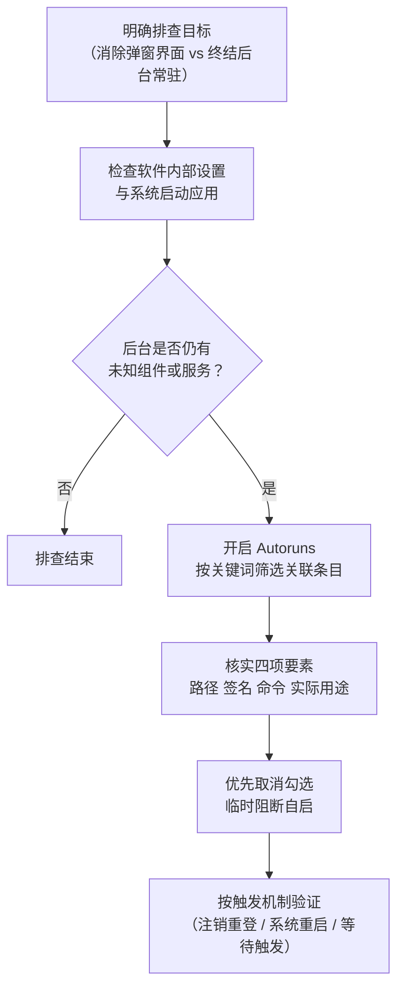

# Windows 启动项，到底该去哪里管？

<!-- DESC SEP -->

用户想管理软件自动运行行为，Windows 启动机制却分散在登录项、后台服务与计划任务中。本文梳理三套机制差异与排查路径。

<!-- DESC SEP -->

## 明明禁用启动应用，为何后台仍有相关进程？

设想一个常见场景。用户在 Windows 11 安装某款网盘或带自动更新功能输入法，不希望软件开机自启，于是在软件设置取消自启动开关，并在任务管理器“启动应用”将状态设为“已禁用”。

重启电脑进入桌面，主程序窗口没有出现，托盘区也不见图标。打开任务管理器查看后台进程，却发现该软件名下 `*Service.exe` 或 `*Updater.exe` 依然常驻内存，持续消耗计算资源。

直觉上，开机自启动针对整款软件生效。只要关闭开关，所有关联组件都不该开机运行。

现代桌面软件鲜少仅由单一可执行文件构成。功能完整软件通常拆分为三个模块。
1. **图形界面客户端（GUI Client）**，负责日常交互，呈现窗口与托盘图标。
2. **后台服务（Windows Service）**，负责跨用户会话文件同步、网络通信或提权维护。
3. **计划任务（Scheduled Task）**，负责定时检查更新、同步状态或上报日志。

任务管理器禁用启动项，通常仅切断登录阶段自动加载主界面通道。后台服务与计划任务由独立子系统调度，依然按照既有规则各自运转。

这种设计并非适用于全部软件，却清晰暴露一个事实，Windows 缺乏统一管控软件全部自启行为全局开关。

## 先分清开机、登录与触发

定位程序启动根源，必须跳出单一界面视角，从三个维度审视。

| 维度 | 关键疑问 | 常见取值与特征 |
| --- | --- | --- |
| **时机（When）** | 何时运行？ | 系统引导（Boot）、用户登录（Logon）、预设时刻、系统事件触发 |
| **身份（Who）** | 凭何种权限运行？ | 系统高权限账户（`SYSTEM` / `LOCAL SERVICE`）、当前登录用户账户 |
| **发起者（How）** | 谁负责拉起进程？ | 服务控制管理器（SCM）、桌面外壳进程（`explorer.exe`）、任务计划引擎 |

首要任务在于厘清**系统启动（Boot）**与**用户登录（Logon）**差异。

系统启动指机器加电引导、载入 Windows 内核、初始化硬件驱动与服务控制管理器阶段。此时尚无普通用户登入，屏幕停留在锁屏或凭据输入界面。此阶段运行载荷基本为高权限系统服务与驱动，没有图形桌面支持，也无法向屏幕弹出窗口。

用户登录则是特定用户通过凭据验证后，系统为其创建交互会话（Session）、加载个人配置并拉起外壳进程 `explorer.exe` 阶段。任务管理器所列自启程序，绝大多数归属这一范畴。

此外，管理界面与底层机制并非一一对应。同一底层配置可以映射至多个界面，同一界面收纳项目，背后可能来自截然不同注册表分支或磁盘目录。

## 登录阶段自启动机制

在用户登录桌面时触发自启动项目，属于日常接触最频繁类型，也是各类系统工具管理最多对象。

### 设置与任务管理器统一视图

在 Windows 10 与 Windows 11 中，系统为登录自启提供两个图形入口。
- **系统设置**，位于“设置 > 应用 > 启动”。
- **任务管理器**，位于“启动应用”分页（Windows 10 对应“启动”分页）。

微软官方文档[在 Windows 中配置启动应用程序](https://support.microsoft.com/en-gb/windows/experience/startup-boot/configure-startup-applications-in-windows)明确指出，二者读取相同应用程序列表。区别仅在呈现维度。系统设置提供直观开关，任务管理器补充启动影响评估、命令行参数与发布者署名。

这份列表只收录用户登入桌面时拉起桌面程序，不覆盖服务与计划任务。

### 启动文件夹专属与共用范围

通过 `Win + R` 调出运行窗口，可快速开启两处启动目录。
- **当前用户专属启动目录**，输入 `shell:startup` 访问。
  ```text
  %APPDATA%\Microsoft\Windows\Start Menu\Programs\Startup
  ```
  该目录快捷方式仅在当前账户登录时执行。

- **全部用户共用启动目录**，输入 `shell:common startup` 访问。
  ```text
  %PROGRAMDATA%\Microsoft\Windows\Start Menu\Programs\Startup
  ```
  共用目录程序同样在用户登录桌面阶段触发，而非开机未登录状态加载。区别在于任意账户登入，系统均会依次运行该目录快捷方式。

### 注册表 Run 与 RunOnce 键值

大部分桌面程序将启动项写入 Windows 注册表。微软官方文档[Run and RunOnce Registry Keys](https://learn.microsoft.com/en-us/windows/win32/setupapi/run-and-runonce-registry-keys)界定核心键值作用机制。

主要配置划分为两类作用域。
1. **当前用户分支（HKCU）**
   ```text
   HKEY_CURRENT_USER\Software\Microsoft\Windows\CurrentVersion\Run
   HKEY_CURRENT_USER\Software\Microsoft\Windows\CurrentVersion\RunOnce
   ```
2. **全局计算机分支（HKLM）**
   ```text
   HKEY_LOCAL_MACHINE\Software\Microsoft\Windows\CurrentVersion\Run
   HKEY_LOCAL_MACHINE\Software\Microsoft\Windows\CurrentVersion\RunOnce
   ```
   64 位系统运行 32 位程序时，还存在 WoW64 映射分支。
   ```text
   HKEY_LOCAL_MACHINE\Software\WOW6432Node\Microsoft\Windows\CurrentVersion\Run
   ```

`Run` 与 `RunOnce` 执行逻辑截然不同。
- `Run` 在每次匹配登录事件发生时反复执行。
- `RunOnce` 面向安装或升级任务，执行单次即自动删除对应键值，防范程序故障导致死循环。

此外，官方规范提及 `HKLM RunOnce` 具备特定执行约束。例如默认排在全部 `Run` 项前同步执行，附带感叹号 `!` 前缀会推迟至命令完全退出才删除条目，在安全模式下默认跳过（除非名称包含星号 `*` 前缀）。排查时掌握这些路径即可，日常不推荐直接手工改动注册表。

## 后台服务与计划任务

若某款软件未在登录自启动列表现身，却长期常驻后台，其自启逻辑往往落在后台服务或计划任务上。

### Windows 服务运行状态与启动类型

按快捷键 `Win + R` 输入 `services.msc` 可调出服务管理器。

根据微软官方文档[自动启动服务](https://learn.microsoft.com/en-us/windows/win32/services/automatically-starting-services)定义，Windows 服务由服务控制管理器（SCM）统筹管理。检查服务配置时，必须严格区分**当前状态**与**启动类型**。

| 启动类型 | 实际行为特征 |
| --- | --- |
| **自动（Automatic）** | 系统引导阶段由 SCM 加载，早于用户登入，支撑底层系统功能 |
| **自动（延迟启动）** | 引导完成且关键载荷平稳后延时加载，缓解开机 I/O 争抢 |
| **手动（Manual）** | 默认随开机不加载，等待其他程序或命令主动唤起 |
| **禁用（Disabled）** | SCM 彻底阻断加载，任何应用或依赖机制均无法启动该服务 |

需要格外警惕“手动”类型。许多用户误以为设为手动即可高枕无忧。自 Windows 7 引入[服务触发事件（Service Trigger Events）](https://learn.microsoft.com/en-us/windows/win32/services/service-trigger-events)机制，服务允许登记特定硬件插入、网络可用或防火墙端口变动触发规则。即便维持“手动”类型，一旦满足触发条件，SCM 依然会立刻拉起该服务。

### 计划任务触发规则与执行要素

按快捷键 `Win + R` 输入 `taskschd.msc` 即可开启任务计划程序。

计划任务属于通用调度框架。依照微软官方文档[任务触发器（Task Triggers）](https://learn.microsoft.com/en-us/windows/win32/taskschd/task-triggers)定义，完整计划任务包含四大要素。
- **触发器（Trigger）**，决定任务启动时机。涵盖系统引导、特定用户登录、固定时刻、系统空闲或事件日志。许多软件正是设定“用户登录 15 分钟后触发”规避开机监控。
- **操作（Action）**，指定具体执行命令与参数。
- **安全上下文（Principal）**，规定运行账户。若指定以 `SYSTEM` 高权限且选择“不管用户登录与否均运行”，便能完全绕过桌面隐蔽运行。
- **附加条件（Conditions）**，限定网络连通或接入电源方可运行。

> [!NOTE]
> 软件后台服务或计划任务常与自动更新、安全补丁修复直接绑定。禁用更新组件可能导致安全风险无法修补，或致使某些硬件协同功能异常。调整前务必确认具体用途。

## 借助 Autoruns 集中排查

面对分散于设置、注册表、服务管理器与任务计划程序多处配置，仅靠系统自带零散工具排查极易遗漏。

微软官方工具 [Autoruns for Windows](https://learn.microsoft.com/en-us/sysinternals/downloads/autoruns) 将系统中几乎所有自动加载项归集在统一视图中，消除跨工具排查痛点。

### 核心视图与快速定位

以管理员身份启动 Autoruns，建议在 `Options` 勾选 `Hide Microsoft Entries`，排除系统自带条目干扰。

排查重点集中于以下分类分页。
- **Logon**，聚合用户登录加载项，包括注册表 `Run`、启动文件夹与相关加载项。
- **Services**，汇总全部第三方服务，标明名称、发布者与文件完整路径。
- **Scheduled Tasks**，展开全部第三方计划任务与其调用脚本。
- **Drivers**，罗列随内核引导加载驱动。

顶部 `Filter` 筛选框输入软件名称、程序文件或目录关键词，Autoruns 即可穿透底层机制，瞬间列出全部关联条目。鼠标右键点击条目，可选用 `Jump to Entry` 跳转注册表位置，或通过 `Jump to Image` 在文件管理器定位实际文件。

### 两点关键认知

使用 Autoruns 时，需要认清两个事实。
1. **取消勾选与彻底删除区别**
   取消条目前勾选框，Autoruns 不会直接销毁原始配置，而是将其备份移入 `AutorunsDisabled` 注册表隔离项或重命名任务文件。该操作完全可逆，若软件出现异常，重新打勾即可恢复。右键菜单点击 `Delete` 则彻底抹除对应条目，不可撤销。
2. **区分常驻进程与按需加载扩展**
   Autoruns 不单抓取开机驻留程序，还会扫描资源管理器扩展（Explorer）、右键菜单外壳扩展与预览模块。这类组件属于外壳调用动态链接库（DLL），并非开机常驻独立进程，切勿盲目清空。`Drivers` 分页驱动程序攸关硬件稳定与系统引导，严禁随意变动。

## 规范排查与验证流程

治理某款软件自启行为，建议遵循五步排查流程。



### 1. 明确预期目标

先界定想要达成结果。究竟仅想阻止开机弹窗，还是杜绝后台任何常驻进程消耗内存网络？目标不同，干预手段截然不同。

### 2. 优先借助软件设置与启动应用

规范软件通常在设置提供自启控制选项。经由软件自身关闭自启最稳妥，程序会自动清理注册任务或修正服务类型。随后在任务管理器“启动应用”确认主程序已禁用。若无多余后台进程，排查即可告一段落。

### 3. 利用 Autoruns 锁定残留项目

若软件未提供彻底关闭入口，且后台仍有活动进程，开启管理员权限运行 Autoruns。在筛选框输入软件关键词，重点核验 `Logon`、`Services` 与 `Scheduled Tasks` 三大分类。

### 4. 核验四要素并优先选用禁用

实施变动前，务必审查四项信息。
- 文件完整路径，确认属于目标软件目录而非系统核心目录。
- 厂商签名验证（Publisher），核实发布企业真伪。
- 命令行参数，辨识 `--check-updates` 或其他附带参数含义。
- 实际承担功能，确认关闭是否会损及核心功能。

确认无误后，优先在 Autoruns 取消勾选，保留回滚空间，避开直接删除。

### 5. 依照触发规则精准验证

针对不同机制采取对应验证手段，免做无用功。
- 调整登录自启项（Logon），仅需**注销当前用户并重新登录**，外壳环境便会重置，无须重启整机。
- 调整系统服务或驱动（Services / Drivers），必须**重启计算机**，唯有经历完整系统引导，SCM 才会执行新启动策略。
- 调整计划任务（Scheduled Tasks），进入任务计划程序核验状态标记为“已禁用”，或手动点击“运行”测试系统拦截反应。

整个治理过程坚持“每次只改一项、改完即刻验证”准则，切忌在不明用途前提下大面积盲目关停条目。

## 为何 systemctl 体验更直观

接触过 Linux 开发者往往感慨其后台服务管理更为清晰。这一体验很大程度源于 systemd 统一架构规范。

以 Debian 或 Ubuntu 为例，systemd 将受管后台实体统称为 Unit，服务对应 `.service` 文件。它提供高度一致命令行管理接口。

```bash
# 查看服务当前运行状态与日志
systemctl status example.service

# 立即启动或停止正在运行服务
sudo systemctl start example.service
sudo systemctl stop example.service

# 启用或关闭开机自动加载
sudo systemctl enable example.service
sudo systemctl disable example.service
```

systemd 核心概念切分极其明晰。
- **运行状态（Active State）**，表征服务当前是否常驻内存（`active` 或 `inactive`），使用 `start` 与 `stop` 调度。
- **启用关联（Unit File State）**，表征系统达到特定目标（如 `multi-user.target`）是否自动挂载符号链接，使用 `enable` 与 `disable` 设定。

这一设计同样包含严格技术边界。根据 [systemctl 官方手册](https://www.freedesktop.org/software/systemd/man/latest/systemctl.html)说明，执行 `systemctl disable` 仅移除开机启动软链接，**绝不会主动终止正在内存运行服务**；若该服务存在其他依赖项调用，或受 Socket、D-Bus 消息唤醒，依然可能按需启动。彻底封禁必须执行 `systemctl mask`。

这并不代表 Windows 底层服务调度落后。

实际上，Windows 底层服务控制管理器（SCM）同样属于成熟集中调度体系，原生命令行工具同样支持精细调控。例如官方文档[sc.exe config](https://learn.microsoft.com/en-us/windows-server/administration/windows-commands/sc-config)介绍具体语法。

```cmd
REM 注意 start= 后面必须保留一个空格
sc.exe config "ExampleService" start= disabled
sc.exe stop "ExampleService"
```

同时，Linux 桌面环境为支撑图形程序自启，同样独立于 systemd 发展出 [XDG 桌面应用程序自启动规范（XDG Autostart）](https://specifications.freedesktop.org/autostart/latest/)，借助 `~/.config/autostart/` 目录中 `.desktop` 文件管理用户登录自启。

Windows 给人留下“混乱难辨”感观根源何在？

症结在于**跨底层机制聚合展现与用户认知模型严重脱节**。

在 Windows 桌面环境中，普通用户接触到启动管理被系统局限在狭隘登录程序开关中。然而软件开发商却能轻而易举将自启逻辑散布进注册表 Run、系统服务、计划任务甚至底层扩展中。

用户意图极其单纯，希望掌控某款软件自动运行行为；系统内置工具却要求用户变身系统管理员，穿梭在互相孤立控制台与注册表分支中排查。Windows 缺乏以“应用程序”为顶层维度统筹呈现自启载荷能力，最终将跨机制梳理排查成本全部转嫁给用户。
